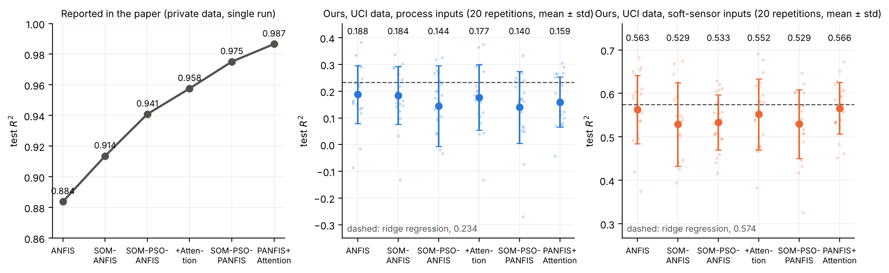

# Attention-infused parallel ANFIS for effluent BOD prediction: re-implementation and stress test

Term project for the Fuzzy Logic (Bulanık Mantık) course.

## Student information

- **Name:** Jack Emre Flett
- **University:** Istanbul University-Cerrahpaşa, Department of Computer Engineering (4th year)
- **Course:** Bulanık Mantık (Fuzzy Logic), term project, November 2026

## Original paper

S. Ramya, S. Srinath, P. Tuppad, V. Chandan, "An attention infused multi-stage parallel adaptive neuro fuzzy
systems framework with metaheuristic optimization for accurate water quality prediction,"
*Discover Artificial Intelligence* 5:359 (2025). https://doi.org/10.1007/s44163-025-00624-y

The paper's data are private and no code was published. Everything here is written from scratch.

## Problem description

Effluent biochemical oxygen demand (BOD) tells whether a wastewater treatment plant cleans the water well
enough, but the lab test takes five days. The task is to estimate effluent BOD from measurements that are
available earlier. The relation is non-linear and noisy, which is why the paper uses a neuro-fuzzy model.

## Method

The paper stacks five stages; this project re-implements the fuzzy ones:

| Stage in the paper | Here |
|---|---|
| AutoGAN feature selection and anomaly handling | replaced by median imputation, IQR clipping and a Spearman rank filter (not a fuzzy component; its formula is not given) |
| SOM initialises the ANFIS membership functions | `src/som.py` |
| PSO (also GA, ACO) tunes the membership functions | `src/optimizers.py` |
| Three attention modules: feature, membership function, rule | `src/anfis.py` |
| Parallel ANFIS (PANFIS): 9 + 16 + 25 rules, fused | `src/pipeline.py` |

## Fuzzy system architecture

First-order Takagi–Sugeno ANFIS, 6 inputs, one output (effluent BOD).

```
Rule k:  IF x1 is A_k1 AND ... AND x6 is A_k6  THEN  f_k = a_k0 + a_k1*x1 + ... + a_k6*x6

Layer 1  fuzzification   mu_ki(x_i) = exp(-(x_i - c_ki)^2 / (2*sigma_ki^2))     Gaussian membership functions
Layer 2  rule firing     w_k = product over i of mu_ki(x_i)                      product T-norm (AND)
Layer 3  normalisation   wbar_k = w_k / sum_j w_j
Layer 4  consequent      wbar_k * f_k
Layer 5  output          y = sum_k wbar_k * f_k        weighted average = Sugeno defuzzification
```

- **Rule base:** one rule per SOM node (9 rules for a single model; 9, 16 and 25 for the three PANFIS branches).
  Every rule has its own Gaussian for every input, so rules do not multiply with the number of inputs.
- **Trainable parameters:** centres `c` and widths `sigma` (premise), coefficients `a` (consequent).
- **Attention (our placement, the paper does not specify it):** feature attention `alpha` and
  membership-function attention `gamma` act as exponents on the membership degrees
  (`mu^(n*alpha)`, `mu^(R*gamma)`: above 1 sharpens, below 1 flattens); rule attention `beta` in [-1, 1]
  scales the normalised firing strength (`wbar*(1+beta)`). All start neutral, so the model begins as a plain ANFIS.

## Dataset

UCI **Water Treatment Plant** (527 daily records, 38 attributes, CC BY 4.0), included in `data/raw/`.
Target: `DBO-S` (effluent BOD, mg/L); 504 records have a target. See `data/README.md`.

Two input scenarios:
- `process`: candidates are the 22 upstream measurements (plant input, primary settler, secondary settler input);
- `softsensor`: additionally the 6 fast effluent measurements (pH, COD, solids, conductivity).

The `RD-*` columns are computed from effluent values (two directly from the target) and are never used.
Imputation, clipping, feature selection and scaling are fitted on the training part only.

## Installation

```bash
git clone https://github.com/Jack-Flett/fuzzy-logic-project.git
cd fuzzy-logic-project
python3 -m venv .venv && source .venv/bin/activate      # Python 3.13; also tested locally on 3.14
pip install -r requirements.txt
python -m pytest -q                                      # 6 unit tests, a few seconds
```

## Requirements

Python 3.13 with `torch 2.15`, `numpy 2.5`, `pandas 3.0`, `scikit-learn 1.9`, `scipy 1.18`, `matplotlib 3.11`
(exact versions in `requirements.txt`). CPU only; no GPU needed. Tested locally on Python 3.14.

## How to run

All commands are run from the repository root.

```bash
python demo.py                                  # live demo: trains in seconds, explains one prediction rule by rule
python demo.py --set DBO-D=180 DQO-D=350        # change inputs (physical units)
python demo.py --row 3 --model panfis-attention # a test-set day with the measured value

python -m experiments.baseline.run_sanity_synthetic   # implementation check on synthetic data (~3 min)
python -m experiments.baseline.run_reproduction       # reproduction experiment (~8 min on 2 cores)
python -m experiments.proposed.run_extension          # extension experiments (~17 min)
python -m experiments.make_report_assets              # tables and figures from the raw results (~1 min)
```

Add `--quick` to the two long scripts for a 2-seed run. All runs are seeded; the raw per-run results that the
report is based on are stored in `results/tables/*_runs.csv`.

## Reproduction experiments

`experiments/baseline/` repeats the paper's main experiment, the six-model progression
ANFIS → SOM-ANFIS → SOM-PSO-ANFIS → +Attention → SOM-PSO-PANFIS → +Attention (plus GA and ACO variants),
with 20 random 70/15/15 splits and a chronological split, and compares it with the paper's reported values
and with non-fuzzy baselines.

## Proposed extension

`experiments/proposed/` adds the controls the paper does not have:

- **E0** repeated runs with paired significance tests (corrected resampled t-test, Wilcoxon);
- **E1** ablation of the three attention levels (all 8 subsets) and a per-sample attention variant;
- **E2** a parameter-matched control for PANFIS (single ANFIS with 50 rules), single 9/16/25-rule models,
  equal vs learned fusion weights, homogeneous 16+16+16 ensemble;
- **E3** PSO fitness measured on validation data instead of training data;
- **E4** robustness to noise on the test inputs, against ridge regression, an MLP and a random forest;
- **E5** the synthetic sanity benchmark.

## Experimental results

Test R² (mean ± std over 20 random splits). Full tables: `results/tables/`, figures: `results/figures/`,
discussion: `report/report.pdf`.

| Model | Parameters | Process inputs | Soft-sensor inputs | Paper (private data) |
|---|---|---|---|---|
| ANFIS | 171 | 0.188 ± 0.108 | 0.563 ± 0.079 | 0.8838 |
| SOM-ANFIS | 171 | 0.184 ± 0.108 | 0.529 ± 0.096 | 0.9136 |
| SOM-PSO-ANFIS | 171 | 0.144 ± 0.151 | 0.533 ± 0.064 | 0.9409 |
| SOM-PSO-ANFIS-Attention | 2,496 | 0.177 ± 0.123 | 0.552 ± 0.082 | 0.9576 |
| SOM-PSO-PANFIS | 950 | 0.140 ± 0.135 | 0.529 ± 0.079 | 0.9751 |
| SOM-PSO-PANFIS-Attention | 13,238 | 0.159 ± 0.094 | 0.566 ± 0.060 | 0.9866 |
| Ridge regression | 7 | 0.234 ± 0.101 | 0.574 ± 0.060 | – |
| MLP (32-16) | 769 | 0.208 ± 0.107 | 0.559 ± 0.069 | – |
| Random forest | – | 0.172 ± 0.119 | 0.577 ± 0.074 | – |



What the experiments show:

- **The code works:** on the synthetic benchmark the ANFIS reaches R² = 0.948 against 0.715 for ridge regression.
- **The paper's progression is not reproduced on public data.** No stage gives a statistically significant gain
  (every p ≥ 0.11), and the signs alternate.
- **A linear model is as good.** Ridge regression (7 parameters) matches or beats every fuzzy model; with
  process inputs the full 13,238-parameter model is significantly worse than ridge (ΔR² = −0.075, p = 0.023).
- **Extension:** no attention level has a detectable effect; PANFIS is not distinguishable from single models
  of similar size; equal fusion weights are at least as good as learned ones; the PSO fitness choice does not
  matter; attention and PANFIS do not improve noise robustness. An equal-weight PANFIS without attention matches
  the paper's final architecture with 93% fewer parameters.
- **The paper's own tables are inconsistent** for its two best models (the implied test-set size changes from
  235 to 272 and 314); see Section IV-A of the report.

## Limitations

- The paper's private dataset is unavailable, so trends are compared, not absolute numbers.
- AutoGAN is replaced by simple statistics; several unspecified details were filled in (Table III of the report).
- The public dataset is small (353 training samples) and noisy; test sets have 75 samples, so effects smaller
  than about ±0.05–0.1 in R² cannot be detected.
- Only six inputs are used, as in the paper. Hyper-parameters are the paper's and were not tuned per model.

## Repository layout

```
src/                    anfis.py, som.py, optimizers.py (PSO/GA/ACO), pipeline.py (PANFIS, model builder),
                        data.py, train.py, metrics.py, baselines.py, config.py (all hyper-parameters)
experiments/baseline/   reproduction + synthetic sanity check
experiments/proposed/   extension experiments
experiments/make_report_assets.py
results/tables/         raw per-run CSVs and summary tables (csv / md / tex)
results/figures/
report/                 report.tex, report.pdf (IEEE format)
presentation/           presentation.tex, presentation.pdf
references/README.md    all cited sources with links
tests/                  unit tests
demo.py                 live demo
```

## Generative AI usage

Generative AI (Anthropic Claude) was used extensively: paper analysis, code, running the experiments and
drafting the report and slides. Commits with AI-written content carry a `Co-Authored-By` line.
All results come from running the code in this repository. Details: "Generative AI Usage Disclosure" in the report.

## References

See `references/README.md` for the full list with links. Key sources: Ramya et al. (2025), the reference paper;
Jang (1993), ANFIS; Takagi & Sugeno (1985); Kohonen (1990), SOM; Kennedy & Eberhart (1995), PSO;
Nadeau & Bengio (2003), corrected resampled t-test; Poch (1993), UCI Water Treatment Plant dataset.

## Licence

Code: MIT (`LICENSE`). Dataset: CC BY 4.0 (UCI). `report/IEEEtran.cls`: LaTeX Project Public License.
